# Unused images: review and delete

Generated 26 Nov 2026. **81 files, 67.8 MB** in `public/images/` that no page, component or content file references.

How to use: open this file with **Markdown: Open Preview** (Ctrl+Shift+V) to see thumbnails. Click a file name to open it full size. Delete the ones you don't need in the Explorer, then tick the box here.

Before deleting, note that `/design-system` (internal) and `src/data/deck-content` were counted as references, so files they use are not listed.

## `/images/case-studies/` (6 files, 3.6 MB)

| Done | Preview | File | Size | Pixels |
| :-: | --- | --- | --: | --: |
| [ ] |  | [clients_s10.jpg](../public/images/case-studies/clients_s10.jpg) | 218 KB | 2000×1125 |
| [ ] |  | [competitive-moat-tower.jpg](../public/images/case-studies/competitive-moat-tower.jpg) | 804 KB | 4001×2250 |
| [ ] | 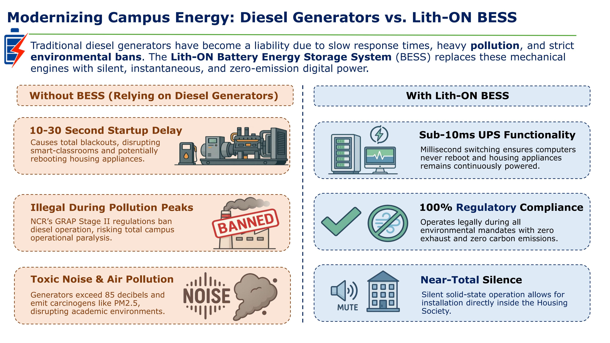 | [diesel-vs-bess-comparison.jpg](../public/images/case-studies/diesel-vs-bess-comparison.jpg) | 819 KB | 4001×2250 |
| [ ] | 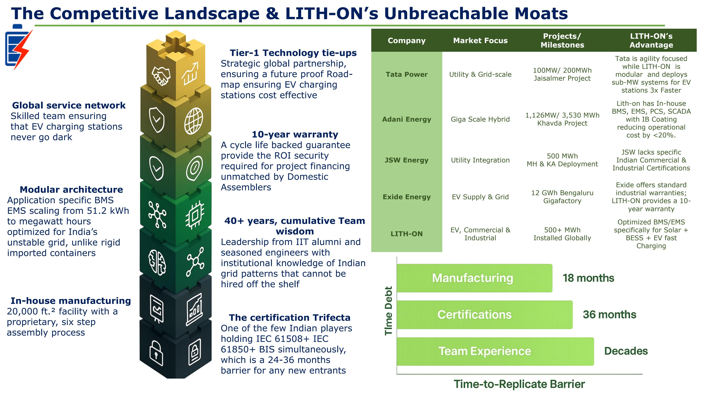 | [housing_s11.jpg](../public/images/case-studies/housing_s11.jpg) | 804 KB | 4001×2250 |
| [ ] |  | [housing_s8.jpg](../public/images/case-studies/housing_s8.jpg) | 819 KB | 4001×2250 |
| [ ] | 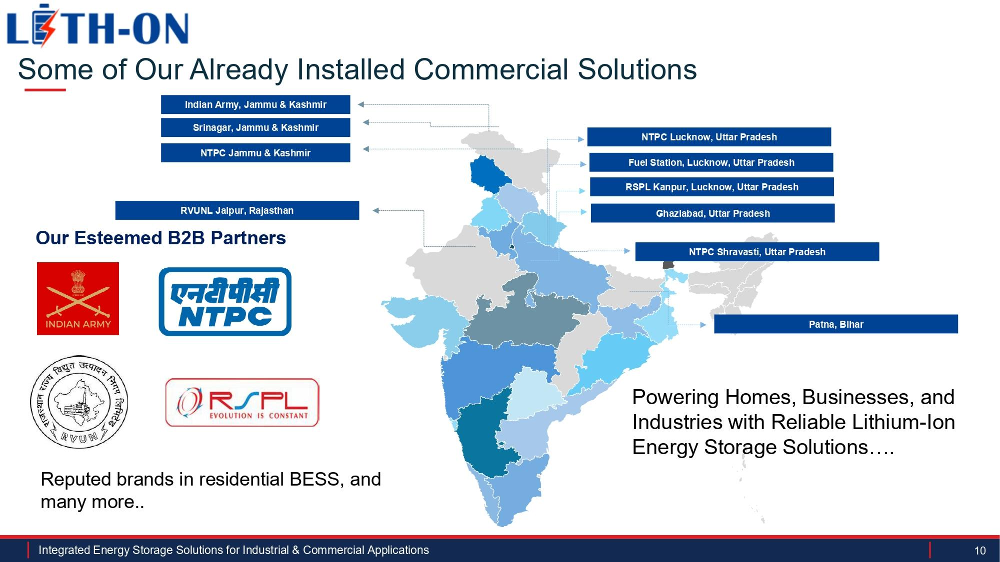 | [india-deployment-map.jpg](../public/images/case-studies/india-deployment-map.jpg) | 218 KB | 2000×1125 |

## `/images/factory/` (9 files, 359 KB)

| Done | Preview | File | Size | Pixels |
| :-: | --- | --- | --: | --: |
| [ ] | 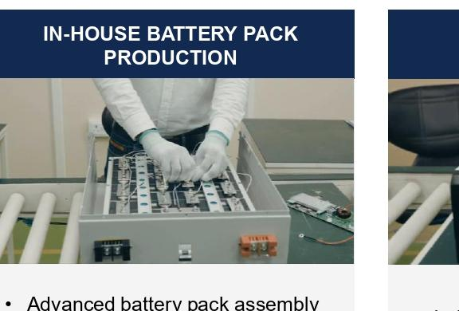 | [battery-pack-assembly.jpg](../public/images/factory/battery-pack-assembly.jpg) | 31 KB | 576×390 |
| [ ] | 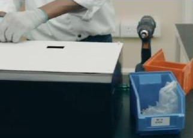 | [integrated-bess-assembly-photo.jpg](../public/images/factory/integrated-bess-assembly-photo.jpg) | 12 KB | 322×230 |
| [ ] | 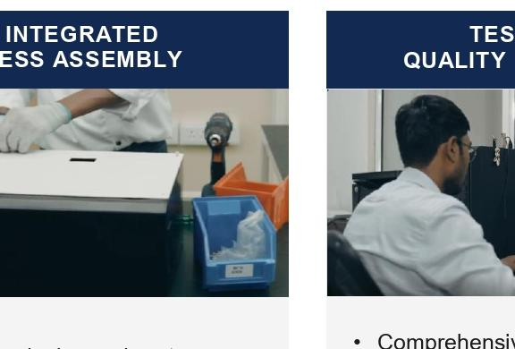 | [integrated-bess-assembly.jpg](../public/images/factory/integrated-bess-assembly.jpg) | 26 KB | 576×390 |
| [ ] | 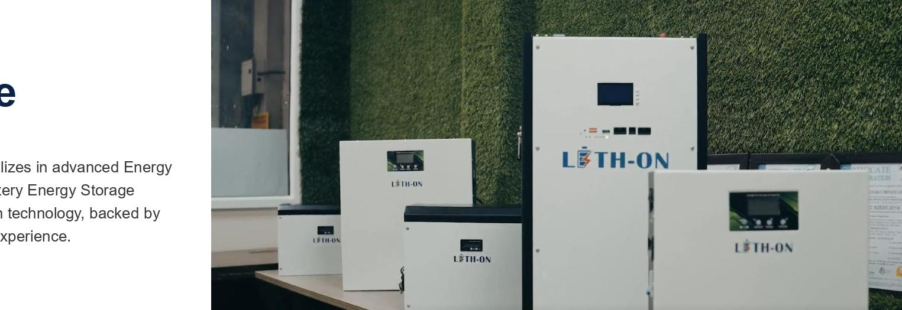 | [noida-facility-bench.jpg](../public/images/factory/noida-facility-bench.jpg) | 87 KB | 1525×525 |
| [ ] | 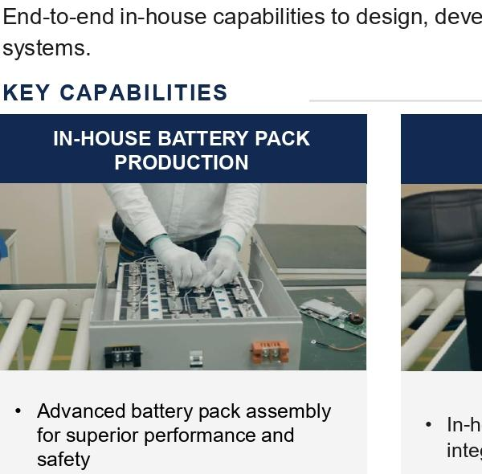 | [test_fac_1.jpg](../public/images/factory/test_fac_1.jpg) | 48 KB | 600×590 |
| [ ] | 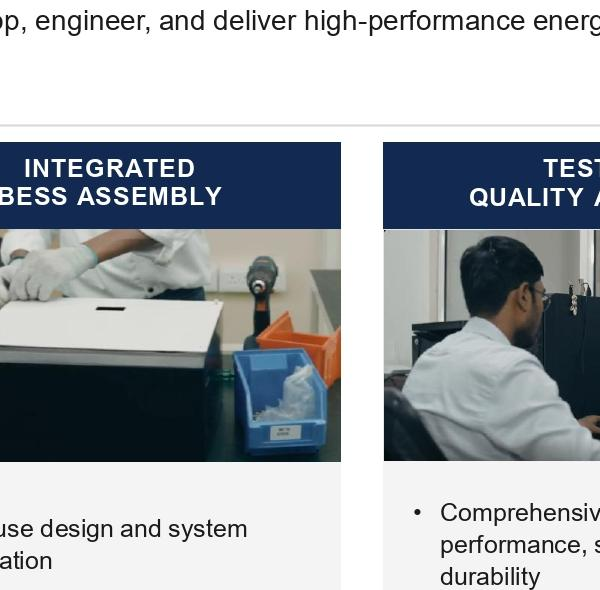 | [test_fac_2.jpg](../public/images/factory/test_fac_2.jpg) | 42 KB | 600×590 |
| [ ] | 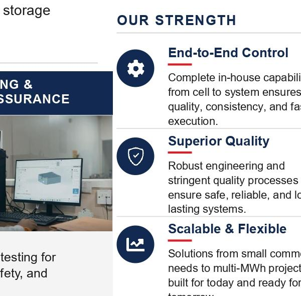 | [test_fac_3.jpg](../public/images/factory/test_fac_3.jpg) | 60 KB | 600×590 |
| [ ] | 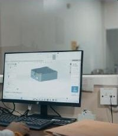 | [testing-quality-assurance-photo.jpg](../public/images/factory/testing-quality-assurance-photo.jpg) | 10 KB | 200×230 |
| [ ] | 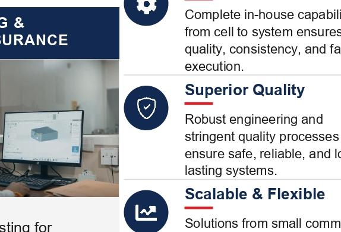 | [testing-quality-assurance.jpg](../public/images/factory/testing-quality-assurance.jpg) | 40 KB | 574×390 |

## `/images/hero/` (15 files, 29.7 MB)

| Done | Preview | File | Size | Pixels |
| :-: | --- | --- | --: | --: |
| [ ] |  | [bess-shelter-anchor.png](../public/images/hero/bess-shelter-anchor.png) | 1.2 MB | 1225×808 |
| [ ] | 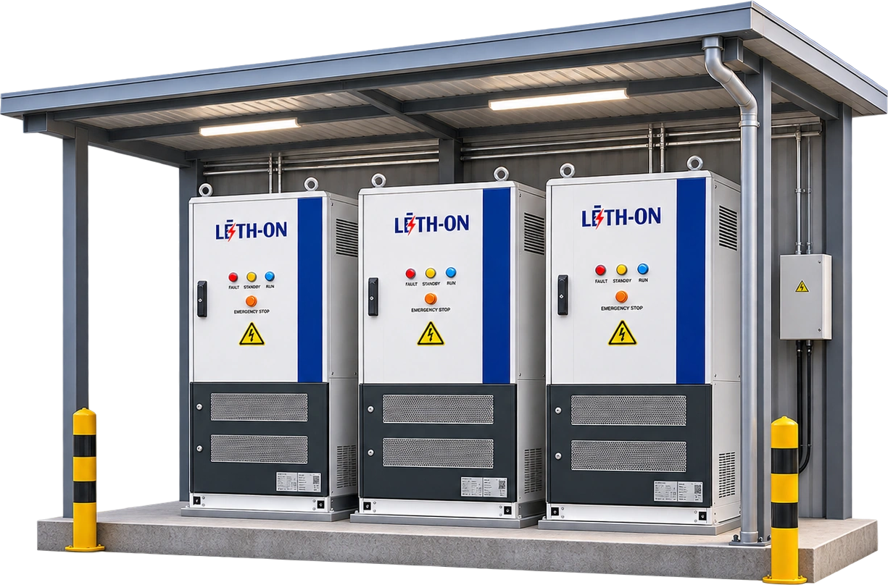 | [bess-shelter-anchor.webp](../public/images/hero/bess-shelter-anchor.webp) | 213 KB | 1225×808 |
| [ ] |  | [new-bg.png](../public/images/hero/new-bg.png) | 10.5 MB | 2752×1536 |
| [ ] |  | [new-bg.webp](../public/images/hero/new-bg.webp) | 2.3 MB | 2752×1536 |
| [ ] | 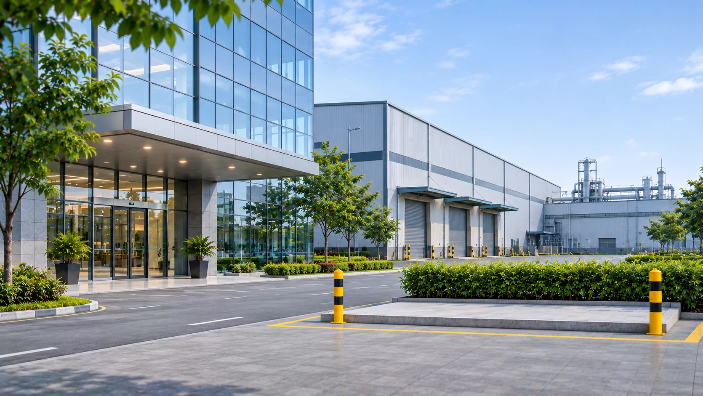 | [scene-commercial.webp](../public/images/hero/scene-commercial.webp) | 263 KB | 1670×941 |
| [ ] | 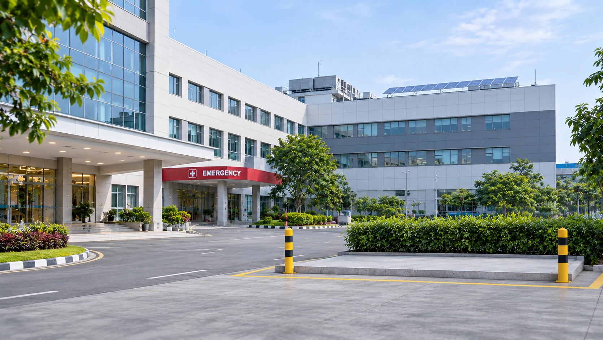 | [scene-hospital.webp](../public/images/hero/scene-hospital.webp) | 270 KB | 1671×941 |
| [ ] | 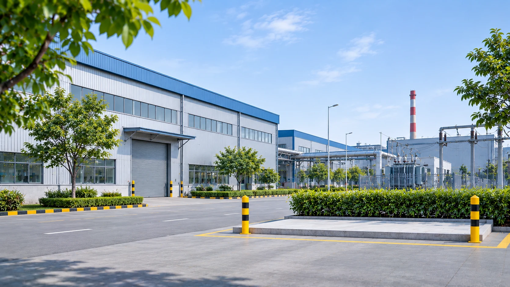 | [scene-industrial.webp](../public/images/hero/scene-industrial.webp) | 282 KB | 1670×941 |
| [ ] | 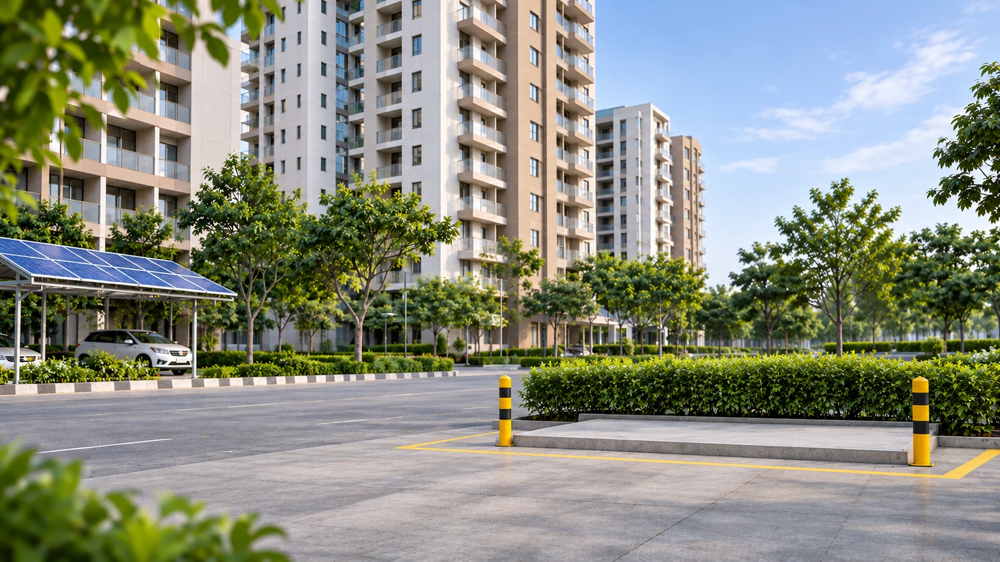 | [scene-residential.webp](../public/images/hero/scene-residential.webp) | 337 KB | 1672×941 |
| [ ] | 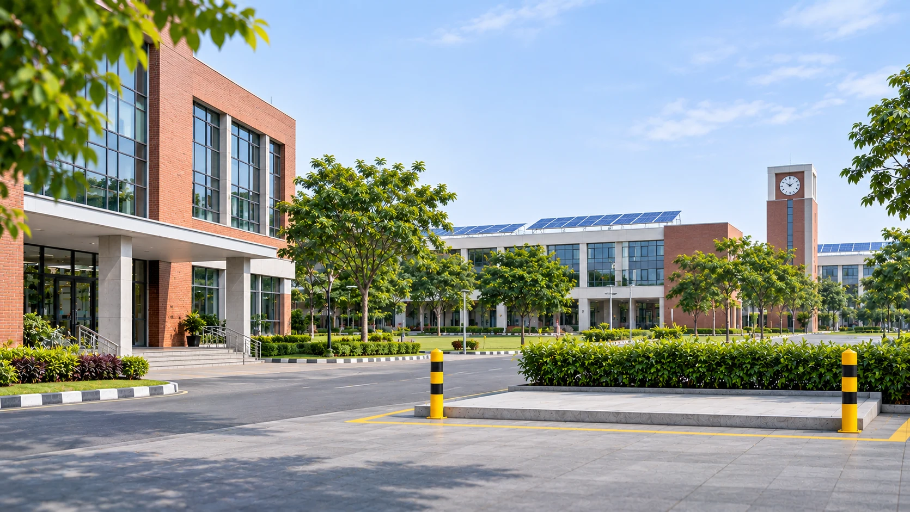 | [scene-university.webp](../public/images/hero/scene-university.webp) | 315 KB | 1671×941 |
| [ ] | 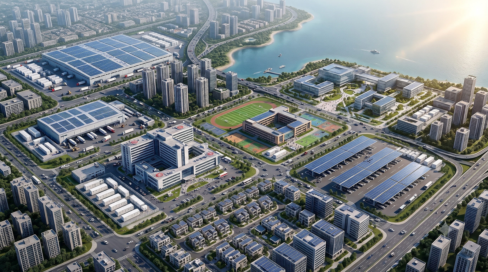 | [smart_energy_city_2x.jpg](../public/images/hero/smart_energy_city_2x.jpg) | 2.7 MB | 2752×1536 |
| [ ] |  | [smart_energy_city_2x.webp](../public/images/hero/smart_energy_city_2x.webp) | 2.3 MB | 2752×1536 |
| [ ] | 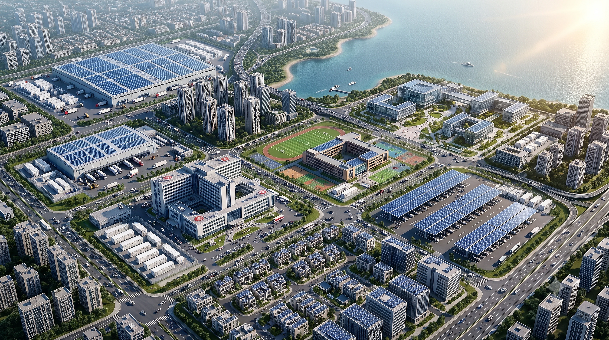 | [smart_energy_city_4k.webp](../public/images/hero/smart_energy_city_4k.webp) | 3.2 MB | 3840×2144 |
| [ ] |  | [smart_energy_city_hd.jpg](../public/images/hero/smart_energy_city_hd.jpg) | 805 KB | 2048×1142 |
| [ ] |  | [smart_energy_city_isometric.jpg](../public/images/hero/smart_energy_city_isometric.jpg) | 2.7 MB | 2752×1536 |
| [ ] |  | [smart_energy_city_isometric.webp](../public/images/hero/smart_energy_city_isometric.webp) | 2.3 MB | 2752×1536 |

## `/images/hero-sec/` (9 files, 28.0 MB)

| Done | Preview | File | Size | Pixels |
| :-: | --- | --- | --: | --: |
| [ ] | 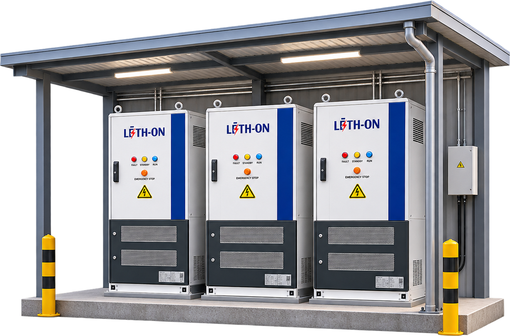 | [bess-shelter-anchor.png](../public/images/hero-sec/bess-shelter-anchor.png) | 1.2 MB | 1225×808 |
| [ ] | 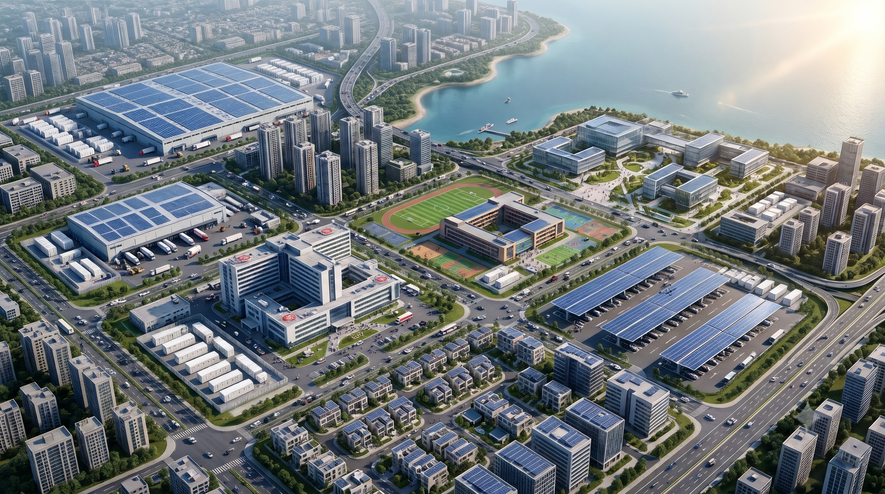 | [new-bg.png](../public/images/hero-sec/new-bg.png) | 10.5 MB | 2752×1536 |
| [ ] |  | [new-bg.webp](../public/images/hero-sec/new-bg.webp) | 2.3 MB | 2752×1536 |
| [ ] |  | [smart_energy_city_2x.jpg](../public/images/hero-sec/smart_energy_city_2x.jpg) | 2.7 MB | 2752×1536 |
| [ ] |  | [smart_energy_city_2x.webp](../public/images/hero-sec/smart_energy_city_2x.webp) | 2.3 MB | 2752×1536 |
| [ ] |  | [smart_energy_city_4k.webp](../public/images/hero-sec/smart_energy_city_4k.webp) | 3.2 MB | 3840×2144 |
| [ ] | 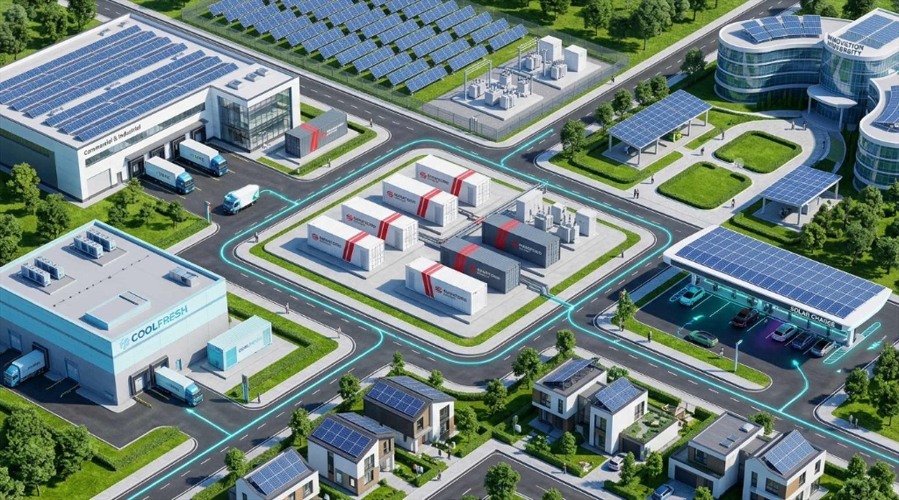 | [smart_energy_city_hd.jpg](../public/images/hero-sec/smart_energy_city_hd.jpg) | 805 KB | 2048×1142 |
| [ ] |  | [smart_energy_city_isometric.jpg](../public/images/hero-sec/smart_energy_city_isometric.jpg) | 2.7 MB | 2752×1536 |
| [ ] |  | [smart_energy_city_isometric.webp](../public/images/hero-sec/smart_energy_city_isometric.webp) | 2.3 MB | 2752×1536 |

## `/images/heroes/` (4 files, 719 KB)

| Done | Preview | File | Size | Pixels |
| :-: | --- | --- | --: | --: |
| [ ] | 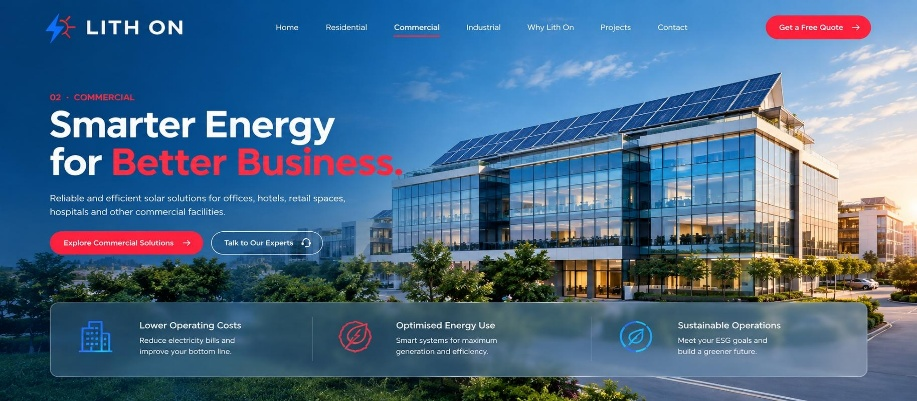 | [hero-commercial.jpg](../public/images/heroes/hero-commercial.jpg) | 161 KB | 917×401 |
| [ ] | 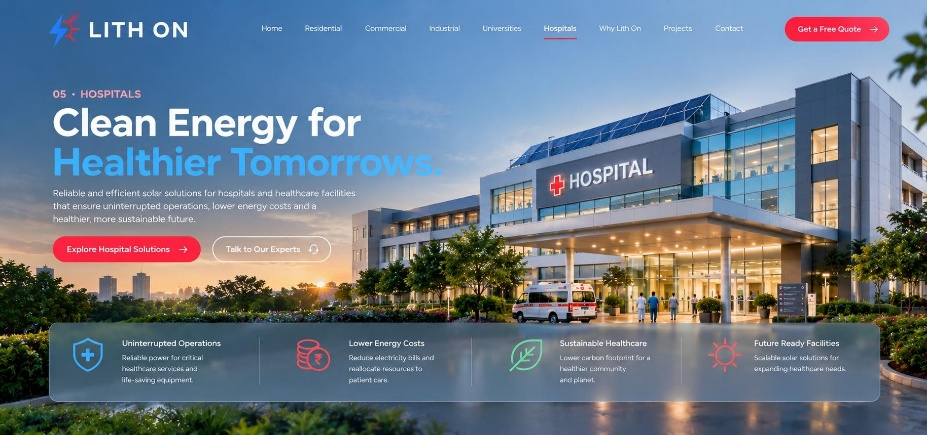 | [hero-hospital.jpg](../public/images/heroes/hero-hospital.jpg) | 169 KB | 927×435 |
| [ ] | 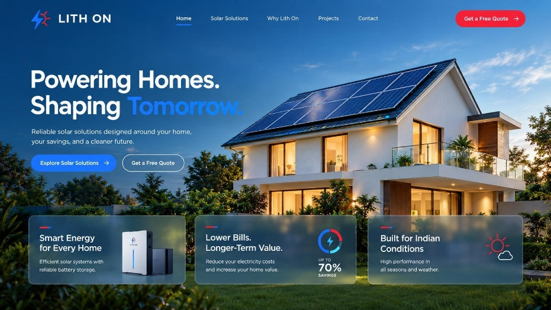 | [hero-residential.jpg](../public/images/heroes/hero-residential.jpg) | 203 KB | 931×524 |
| [ ] | 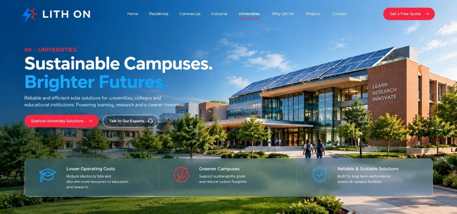 | [hero-university.jpg](../public/images/heroes/hero-university.jpg) | 184 KB | 927×435 |

## `/images/industries/` (1 files, 330 KB)

| Done | Preview | File | Size | Pixels |
| :-: | --- | --- | --: | --: |
| [ ] |  | [residential-sector.webp](../public/images/industries/residential-sector.webp) | 330 KB | 1672×941 |

## `/images/installations/` (9 files, 345 KB)

| Done | Preview | File | Size | Pixels |
| :-: | --- | --- | --: | --: |
| [ ] | 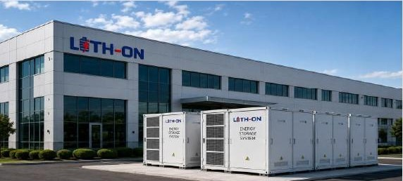 | [commercial-campus-bess-photo.jpg](../public/images/installations/commercial-campus-bess-photo.jpg) | 39 KB | 572×258 |
| [ ] | 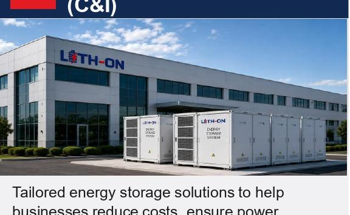 | [commercial-campus-bess.jpg](../public/images/installations/commercial-campus-bess.jpg) | 35 KB | 576×355 |
| [ ] | 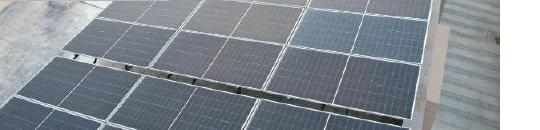 | [invertis-900kw-solar.jpg](../public/images/installations/invertis-900kw-solar.jpg) | 13 KB | 540×130 |
| [ ] | 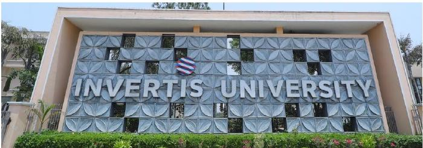 | [invertis-university-facade.jpg](../public/images/installations/invertis-university-facade.jpg) | 44 KB | 700×245 |
| [ ] | 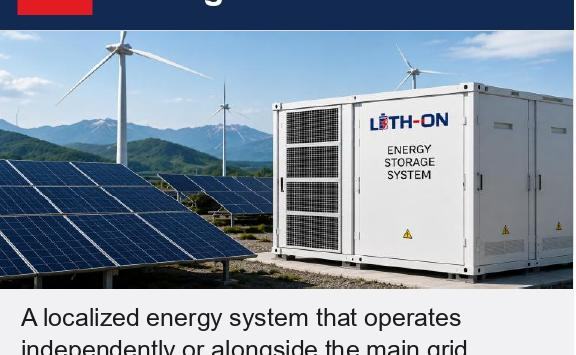 | [microgrid-solar-wind.jpg](../public/images/installations/microgrid-solar-wind.jpg) | 37 KB | 576×355 |
| [ ] | 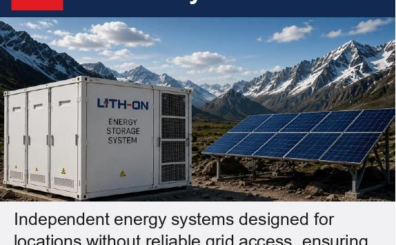 | [mountain-defense-offgrid.jpg](../public/images/installations/mountain-defense-offgrid.jpg) | 44 KB | 574×355 |
| [ ] | 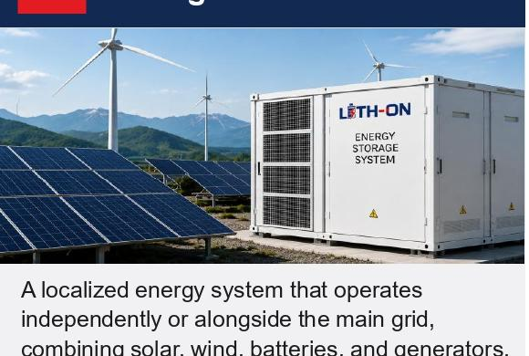 | [test_inst_1.jpg](../public/images/installations/test_inst_1.jpg) | 42 KB | 580×390 |
| [ ] | 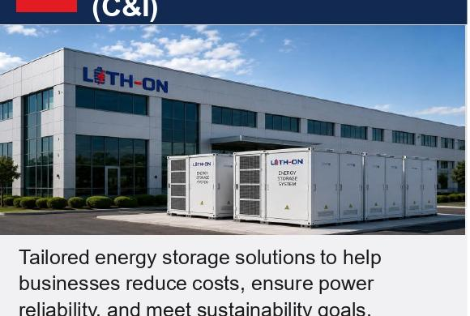 | [test_inst_2.jpg](../public/images/installations/test_inst_2.jpg) | 40 KB | 580×390 |
| [ ] | 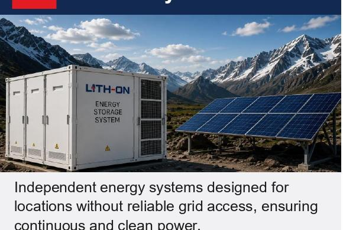 | [test_inst_3.jpg](../public/images/installations/test_inst_3.jpg) | 47 KB | 580×390 |

## `/images/logo/` (1 files, 11 KB)

| Done | Preview | File | Size | Pixels |
| :-: | --- | --- | --: | --: |
| [ ] |  | [logo-light.png](../public/images/logo/logo-light.png) | 11 KB | 532×133 |

## `/images/products/` (16 files, 890 KB)

| Done | Preview | File | Size | Pixels |
| :-: | --- | --- | --: | --: |
| [ ] | 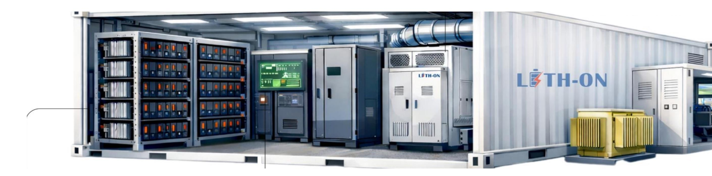 | [bess-3d-cutaway.jpg](../public/images/products/bess-3d-cutaway.jpg) | 167 KB | 2820×700 |
| [ ] | 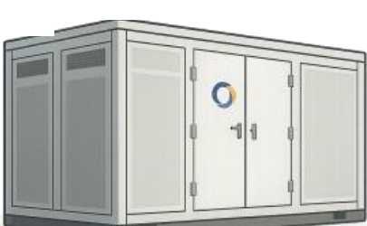 | [bess-enclosure-clean.png](../public/images/products/bess-enclosure-clean.png) | 62 KB | 405×250 |
| [ ] | 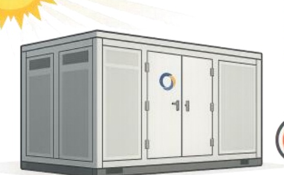 | [bess-hyundai-clean.png](../public/images/products/bess-hyundai-clean.png) | 76 KB | 470×290 |
| [ ] | 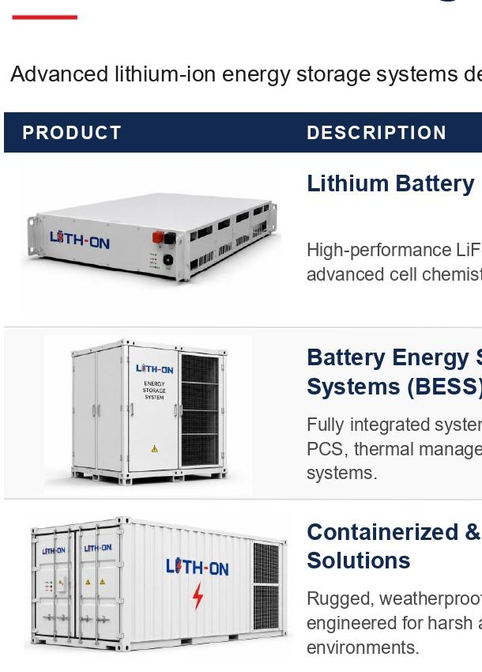 | [crop_test_1.jpg](../public/images/products/crop_test_1.jpg) | 68 KB | 610×850 |
| [ ] | 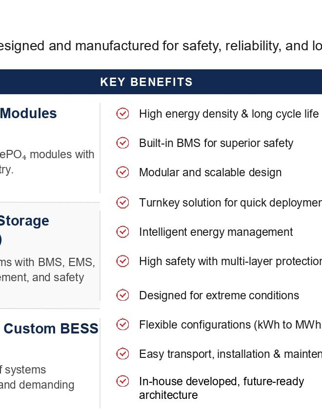 | [crop_test_2.jpg](../public/images/products/crop_test_2.jpg) | 71 KB | 660×850 |
| [ ] | 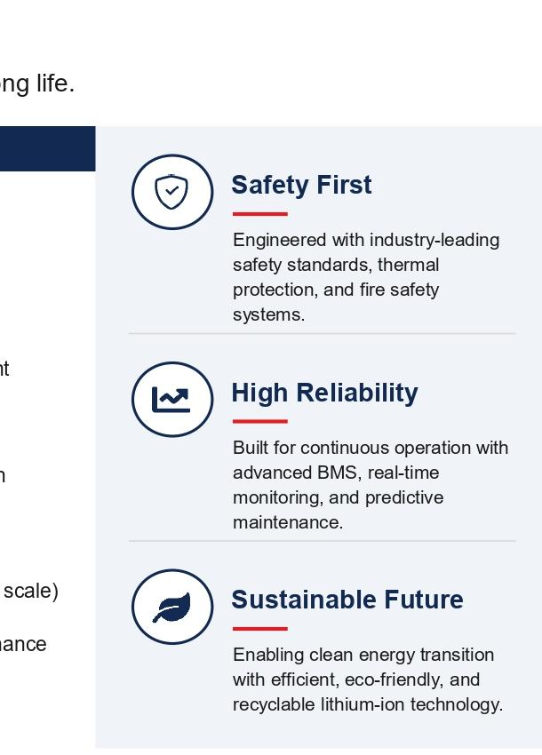 | [crop_test_3.jpg](../public/images/products/crop_test_3.jpg) | 50 KB | 610×850 |
| [ ] | 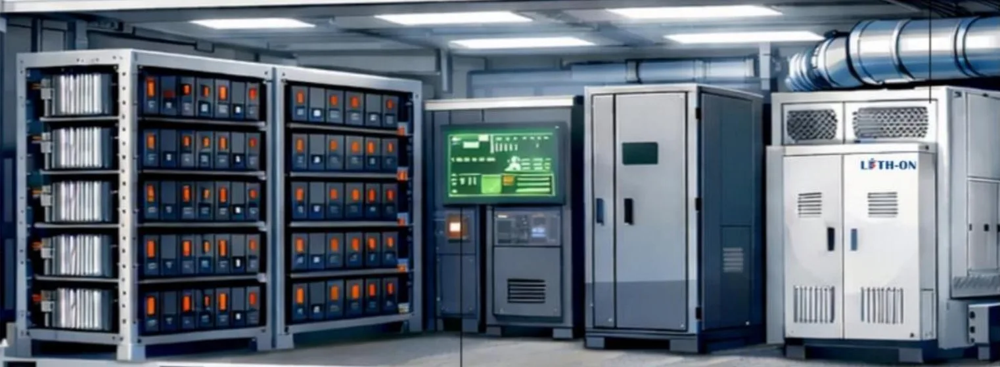 | [cutaway-interior.webp](../public/images/products/cutaway-interior.webp) | 60 KB | 1522×560 |
| [ ] | 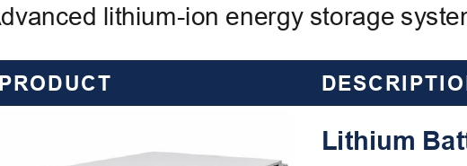 | [lithon-50-module.png](../public/images/products/lithon-50-module.png) | 25 KB | 520×185 |
| [ ] | 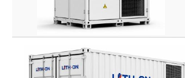 | [lt215-clean-hd.png](../public/images/products/lt215-clean-hd.png) | 35 KB | 380×160 |
| [ ] | 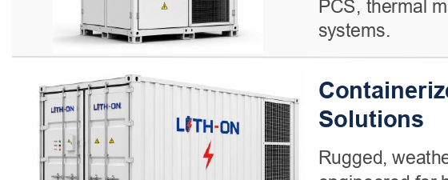 | [lt215-container.png](../public/images/products/lt215-container.png) | 80 KB | 560×225 |
| [ ] | 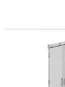 | [magna-ci-cabinet-transparent.png](../public/images/products/magna-ci-cabinet-transparent.png) | 3 KB | 130×175 |
| [ ] | 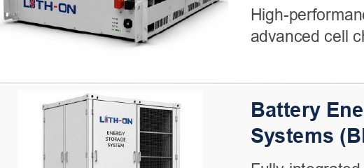 | [magna-ci-cabinet.png](../public/images/products/magna-ci-cabinet.png) | 68 KB | 520×240 |
| [ ] | 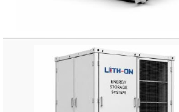 | [magna-ci-clean-hd.png](../public/images/products/magna-ci-clean-hd.png) | 23 KB | 295×185 |
| [ ] | 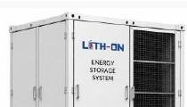 | [magna-ci-clean.png](../public/images/products/magna-ci-clean.png) | 20 KB | 210×120 |
| [ ] |  | [magna-ci-isolated.png](../public/images/products/magna-ci-isolated.png) | 40 KB | 260×240 |
| [ ] |  | [test-middle-row.png](../public/images/products/test-middle-row.png) | 34 KB | 460×200 |

## `/images/scenes/` (2 files, 516 KB)

| Done | Preview | File | Size | Pixels |
| :-: | --- | --- | --: | --: |
| [ ] |  | [hospital.webp](../public/images/scenes/hospital.webp) | 246 KB | 1672×941 |
| [ ] |  | [industrial-storage.webp](../public/images/scenes/industrial-storage.webp) | 269 KB | 1672×941 |

## `/images/sectors/` (5 files, 1.6 MB)

| Done | Preview | File | Size | Pixels |
| :-: | --- | --- | --: | --: |
| [ ] |  | [campus-sector.webp](../public/images/sectors/campus-sector.webp) | 371 KB | 1672×941 |
| [ ] |  | [commercial-sector.webp](../public/images/sectors/commercial-sector.webp) | 320 KB | 1672×941 |
| [ ] |  | [hospital-sector.webp](../public/images/sectors/hospital-sector.webp) | 298 KB | 1672×941 |
| [ ] |  | [industrial-sector.webp](../public/images/sectors/industrial-sector.webp) | 281 KB | 1672×941 |
| [ ] |  | [residential-sector.webp](../public/images/sectors/residential-sector.webp) | 330 KB | 1672×941 |

## `/images/technology/` (4 files, 1.8 MB)

| Done | Preview | File | Size | Pixels |
| :-: | --- | --- | --: | --: |
| [ ] |  | [hyundai_s6.jpg](../public/images/technology/hyundai_s6.jpg) | 578 KB | 4001×2250 |
| [ ] |  | [hyundai_s7.jpg](../public/images/technology/hyundai_s7.jpg) | 750 KB | 4001×2250 |
| [ ] |  | [icebattery-heat-retention.jpg](../public/images/technology/icebattery-heat-retention.jpg) | 332 KB | 1800×1930 |
| [ ] |  | [icebattery-thermodynamics.jpg](../public/images/technology/icebattery-thermodynamics.jpg) | 228 KB | 1970×1300 |
